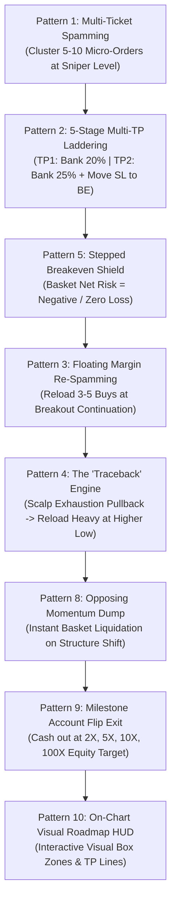

# 🚀 Aggressive Account-Flipper Master Suite: The 10 Behavioral Patterns & Execution Psychology

**Author:** Quantitative Algorithmic Trading Architecture  
**Asset Focus:** Gold (`XAUUSD`) & High-Beta Momentum Assets  
**Objective:** Reverse-engineer and algorithmically institutionalize the exact minute execution tactics, psychology, and risk mechanics used by top online "account flippers" (turning $50-$100 into $1,000-$10,000 in single trading sessions).

---

## 1. The Fundamental Paradox: Why Conventional "Passive" Trading Fails Small Accounts

Standard retail trading dogma preaches:
* *"Take 1 trade at 1:2 R:R, set your Stop Loss and Take Profit, and close your laptop."*
* *"Never add to winning positions."*
* *"Risk 1% per trade."*

### The Small-Account Mathematical Reality Check:
* On a **$100 account** at 1% risk ($1.00), a standard 0.01 lot position with a 20-pip stop and a 40-pip target yields **+$4.00**.
* To grow $100 to $1,000 would require **225 consecutive winning trades** without a drawdown sequence.
* More dangerously, sitting passively on a single position until TP allows normal market pullbacks to reverse into breakeven or stop-outs, causing psychological frustration and churn.

In contrast, top aggressive traders who flip accounts on TikTok, YouTube, and Telegram operate on a completely different set of **asymmetric micro-mechanics**:
1. They **cluster orders** (button spamming) to enable fractional harvesting.
2. They **ladder multiple targets (TP1 to TP5)** to bank profit immediately while derisking the remaining basket.
3. They use **floating broker profits as free margin** to reload winning impulses.
4. They scalp the **"traceback" (pullbacks)** between major impulses to monetize two-way market flow.
5. They **draw real-time visual roadmaps on their charts** so they can visually track every layer, zone, and breakeven shield.

---

## 2. The 10 Core Behavioral Patterns of High-Velocity Account Flippers

---

### Pattern 1: Micro-Ticket Cluster Spamming (The "Button Spam" Multi-Entry Basket)
* **The Logic**: Rather than opening a single static order of 0.10 lot, the trader spams the buy button 5 to 10 times with micro-lots (e.g., $10 \times 0.01$ lot).
* **The Psychological & Quantitative Edge**:
  1. Spreads execution across tight micro-ticks within the entry zone.
  2. Solves broker partial-close limitations: instead of partial-close requests which brokers often slip or reject, individual tickets can be closed atomically via standard market orders.
  3. Enables distinct tickets to be assigned independent staggered targets (TP1, TP2, TP3, TP4, TP5).

---

### Pattern 2: 5-Stage Multi-Take-Profit Laddering (TP1 to TP5)
* **The Logic**: Account flippers never let a 40-pip winner reverse back into a loss. They harvest profits aggressively in waves:
  * **TP1 (+15 to +20 pips)**: Closes **20% of tickets** (e.g., 2 of 10). Banks immediate cash covering broker spread and transaction costs.
  * **TP2 (+35 to +40 pips)**: Closes **25% of tickets** (e.g., 3 of 10). Banks core profit. Triggers **Pattern 5** (moves all remaining stop losses to Breakeven $+ 1\text{ pip}$).
  * **TP3 (+60 to +75 pips)**: Closes **25% of tickets**. Trails stop loss into locked profit (+25 pips).
  * **TP4 (+100 to +120 pips)**: Closes **20% of tickets**. High-yield expansion harvest.
  * **TP5 (+150 to +250 pips)**: Leaves **10% runner** protected by ATR trailing stop to capture multi-session macro trend runs.

---

### Pattern 3: Floating Margin Re-Spamming (Velocity Layer Pyramiding)
* **The Logic**: In MT5 and modern brokers, usable Free Margin is calculated dynamically:
  $$\text{Free Margin} = \text{Account Equity} - \text{Used Margin}$$
* When Layer 1 reaches $+35\text{ pips}$ and earlier tickets are protected at Breakeven, the account equity has expanded (e.g., from $100 to $225).
* The trader uses this newly unlocked collateral to **spam Layer 2 (3 to 5 new tickets)** in the direction of the momentum break!
* When Layer 2 moves $+25\text{ pips}$, its stop loss is moved to Breakeven, Layer 1 stop loss is locked higher, and the basket expands geometrically with zero net risk.

---

### Pattern 4: The "Traceback" Engine (Pullback Micro-Scalp + Trend HL Reload)
* **The Logic**: Markets move in waves (Impulse $\rightarrow$ Retracement $\rightarrow$ Continuation). Account flippers monetize both sides of the wave:
  1. **Primary Uptrend**: Price drives higher into resistance / Higher High (HH).
  2. **Exhaustion Signal**: Candle prints a $\ge 40\%$ upper rejection wick at structural resistance.
  3. **The Traceback Micro-Scalp**: The trader enters a small counter-trend scalp selling the pullback.
  4. **The Higher Low (HL) Extraction**: The traceback sell is closed strictly at the Fibonacci 50%-61.8% retracement or structural Higher Low support.
  5. **The Heavy Trend Reload**: The moment the traceback sell closes, the trader **slams aggressive continuation buys** off the Higher Low bounce, riding the next major impulse wave!

---

### Pattern 5: Stepped Breakeven Shield (Cascading Zero-Risk Math)
* **The Logic**: Protects the account from flash spikes:
  * Step 0 (At Entry): Stop Loss placed tightly behind the sniper invalidation level (15–20 pips).
  * Step 1 (Upon TP1 Hit): Stop Loss held or moved to half-risk.
  * Step 2 (Upon TP2 Hit): Stop Loss moved to **Breakeven $+ 10\text{ points}$ (+1.0 pip buffer)**. Net risk becomes \$0.00.
  * Step 3 (Upon TP3 Hit): Stop Loss trailed into locked profit at $+250\text{ points}$ (+25 pips). Net risk becomes **$-\$50.00$ (Guaranteed Profit)**.
  * Step 4 (Upon TP4 Hit): Stop Loss trailed to $+600\text{ points}$ (+60 pips).

---

### Pattern 6: High-Velocity Killzone Injection (Timing the Spam)
* **The Logic**: Firing spam baskets in low-liquidity Asian consolidation causes chop stop-outs.
* The execution engine strictly synchronizes with institutional liquidity killzones:
  * **London Killzone (07:00 – 11:00 UTC)**: Primary European volume expansion.
  * **New York Overlap Killzone (12:30 – 16:30 UTC)**: Highest daily volatility and macro news releases.
* Outside these killzones, new spam sequences are inhibited.

---

### Pattern 7: Liquidity Sweep & Rejection Wick Confirmation
* **The Logic**: Smart money hunts retail stop orders above session highs or below session lows before reversing.
* The engine verifies:
  1. A swing high/low or Asian boundary was breached (the liquidity grab).
  2. The trigger candle closes back inside the range printing a **rejection wick $\ge 35\%$ of total candle range**.
  3. Only upon wick confirmation is the initial spam cluster triggered.

---

### Pattern 8: Opposing Momentum Exhaustion Dump (Atomic Basket Wipe)
* **The Logic**: Passive traders watch an open trade go from +80 pips back to zero because they refuse to close before an arbitrary TP line.
* Active flippers dump the entire basket immediately if:
  1. An opposing rejection wick ($\ge 45\%$) forms at key resistance against the basket.
  2. Trend momentum (e.g. AO histogram or EMA slope) flips direction.
  3. The EA executes an atomic `CloseAllBasket()` call to bank floating equity without hesitation.

---

### Pattern 9: Asymmetric Account Flip Milestones ($100 \rightarrow \$300 \rightarrow \$1,000 \rightarrow \$10,000$)
* **The Logic**: Account flipping requires defined extraction checkpoints:
  * Milestone 1 (2X / 100% ROI): Account hits \$200 $\rightarrow$ Lock initial \$100 risk.
  * Milestone 2 (5X / 400% ROI): Account hits \$500 $\rightarrow$ Secure profits.
  * Milestone 3 (10X / 900% ROI): Account hits \$1,000.
  * Milestone 4 (100X): Account hits \$10,000 $\rightarrow$ Complete basket liquidation and terminal halt.

---

### Pattern 10: Interactive On-Chart Visual Roadmap & HUD Dashboard
* **The User-Facing Visual Experience**: Trading should not be a black box. The chart must display:
  1. **Dracula Dark Mode Base** (#282A36 dark navy background, clean gridless layout).
  2. **Colored Position Boxes**:
     * Bright Green (`#50FA7B`) for profitable TP zones.
     * Coral Red (`#FF5555`) for stop-loss invalidation zones.
  3. **Visual Target Dividers**:
     * Distinct horizontal dotted lines for TP1, TP2, TP3, TP4, TP5.
     * Dynamic Cyan (`#8BE9FD`) line for the trailing Breakeven shield.
  4. **Structure Labels**: Text markers identifying Higher Highs (`[HH]`) and Higher Lows (`[HL]`).
  5. **Real-Time On-Chart HUD Dashboard**:
     * Active Open Tickets & Total Basket Floating PnL.
     * Current Pyramiding Layer (Layer 1 / Layer 2 / Layer 3).
     * Breakeven Status (UNLOCKED / LOCKED / IN PROFIT).
     * Flip Milestone Progress Bar (% towards target).
