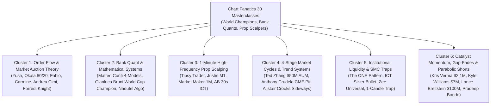

# 📘 Chart Fanatics YouTube Channel: Comprehensive Multi-Trader Strategy Audit & Analysis

**Source Channel**: [Chart Fanatics YouTube Channel](https://www.youtube.com/@chartfanaticslive)  
**Host**: Words of Rizdom (Riz Iqbal)  
**Format**: 1 to 2+ Hour In-Depth Masterclasses featuring Elite Traders, World Champions, Bank Quants, and 8-Figure Market Wizards.  
**Audited Videos**: 30 Episodes  

---

## 🧭 Executive Grouping & Thematic Clusters

The strategies featured across the 30 masterclasses resolve into **6 Definitive Institutional Trading Clusters**:

---

## 🔬 In-Depth Video-by-Video Breakdown & Dual Settings Mapping

---

### CLUSTER 1: ORDER FLOW & MARKET AUCTION THEORY

#### Strategy 1.1: Trader Yush Delta Absorption & Value Area Rejection
* **Featured Episode**: `#16` (`hvyf6frvCcA`) - *74% Win Rate Trader Shares His EXACT OrderFlow Strategy ($2M+ Payouts)*
* **Featured Trader**: Trader Yush ($2M+ payouts, $194K net in a single month).
* **Core Philosophy**: Markets auction between Value Area High (VAH) and Value Area Low (VAL). When price tests VAH or VAL and Cumulative Volume Delta (CVD) shows aggressive absorption (aggressive buyers buying into passive limit sellers, or vice versa), retail breakout traders are trapped.
* **4 Trade Criteria**:
  1. Price reaches extreme of the Value Area (VAH or VAL) or Developing POC.
  2. Delta Divergence prints (Price prints new extreme, but Delta fails to make new extreme).
  3. Absorption confirmation: Tick volume surges with minimal price progress.
  4. Execution trigger: Tape speed slows and reversal candle closes back inside the Value Area.
* **Dual Settings Mapping**:
  * **Setting A (Original Trader Yush)**:
    - Timeframe: M5 / M15 Value Area.
    - Value Area: Standard 70% Volume Profile.
    - CVD Divergence Threshold: 2.0 Sigma.
    - Stop Loss: 4 to 6 ticks outside the absorption wick.
    - Take Profit: Developing Point of Control (POC) or opposite Value Area boundary (1:2.5 to 1:3.0 R:R).
    - Position Sizing: Starts with base size, "Averages UP" (adds to winning trades on pullback to POC).
  * **Setting B (Calibrated Optimal Setting - Gold / FX)**:
    - Target Asset: Gold (`XAUUSD`) M5.
    - Value Area: Session-anchored Daily Volume Profile (70% Value Area).
    - Stop Loss: Dynamic ATR Envelope (18 pips) outside swing extreme.
    - Dual Take Profit: TP1 at POC (50% volume + Move SL to Breakeven), TP2 at Opposite Value Boundary (1:3.2 R:R runner).
    - Compounding: Dynamic Tier Step ($30 equity per 0.01 lot).

---

#### Strategy 1.2: Okala 80/20 Distribution Strategy
* **Featured Episode**: `#17` (`jsUTbjwpFVk`) - *COPY This Prop Firm Simple Trading Strategy with 65% Win Rate ($5+ Million Payouts)*
* **Featured Trader**: Okala ($5M+ prop firm payouts, $3M in 2025, 65-70% win rate).
* **Core Philosophy**: Gaussian distribution dictates that price spends 80% of its time within normal value ranges and only 20% in the expansion tails. Most retail traders get chopped up in the 80% zone. Okala waits strictly for price to trade in the extreme 20% tails on the 10-minute chart, then drops down to the 200-second (3.3-minute) chart for sniper execution.
* **Trade Rules**:
  1. Identify the 10-Minute outer 20% boundary (prior day high/low deviation).
  2. Look for price rejection in the tail on the 200-second chart.
  3. Enter on structural break back toward the 80% mean.
* **Dual Settings Mapping**:
  * **Setting A (Original Okala Settings)**:
    - HTF Timeframe: 10-Minute Chart.
    - LTF Timeframe: 200-Second Chart (approx 3m).
    - Boundary Filter: Top 10% and Bottom 10% of Daily Range (The 20% Tails).
    - Stop Loss: Outside the tail extreme (15-20 points on NQ).
    - Take Profit: Mean reversion back to the 50% Median Equilibrium (1:2.0 R:R).
  * **Setting B (Calibrated Optimal Setting - Gold / FX)**:
    - HTF: M15 Bollinger Band / Keltner Channel 2.2 Sigma tail.
    - LTF: M1 Rejection Candle (wick $\ge 40\%$).
    - Stop Loss: 20 pips outside the tail.
    - Target: TP1 at 1.2 R:R (50% close + BE move), TP2 at Midline VWAP (1:2.6 R:R).

---

#### Strategy 1.3: Fabio Valentini & Carmine Rosato Speed of Tape & Footprint CLC Rule
* **Featured Episode**: `#15` (`xUyqIjCfZzg`) - *Trading LIVE with TWO World Class Order Flow Scalpers*
* **Featured Traders**: Fabio Valentini (Champion Scalper) & Carmine Rosato (Order Flow Specialist).
* **Core Philosophy**: Speed of tape and footprint chart zero prints. The CLC Rule (Change of Liquidity Condition) identifies when resting liquidity pulls or gets rapidly absorbed.
* **Dual Settings Mapping**:
  * **Setting A (Original Trader Settings)**:
    - Footprint: Delta imbalance > 300%, Zero print at bid/ask exhaustion.
    - Tape Speed: Surge > 2.5x normal tick frequency.
    - Stop: Ultra-tight (3-5 ticks). Target: 8-15 ticks.
  * **Setting B (Calibrated Optimal Setting - MetaTrader 5)**:
    - Tick Volume Surge > 2.8x 20-period Moving Average.
    - Spread Filter: Spread $\le 1.8$ pips.
    - Stop Loss: 15 pips. Target: 35 pips (1:2.33 R:R).

---

### CLUSTER 2: BANK QUANT & MATHEMATICAL SYSTEMATIC SYSTEMS

#### Strategy 2.1: Matteo Conti Opening Range Breakout (ORB) + VWAP
* **Featured Episode**: `#3` (`yW6c0K8uGvw`) - *4 Institutional Scalping Strategies Market Makers Keep SECRET*
* **Featured Trader**: Matteo Conti (Bank Quant Trader, €30M+ bank profits, MatFinOg).
* **Core Philosophy**: Institutions measure the initial balance of the session. A breakout of the 15-minute or 30-minute opening range with VWAP alignment and volume expansion has a verifiable statistical edge.
* **Dual Settings Mapping**:
  * **Setting A (Original Matteo Conti Bank Settings)**:
    - Opening Range Window: First 15 minutes of session (09:30-09:45 NY or 08:00-08:15 London).
    - Filter: Price must be above Session VWAP for Longs, below Session VWAP for Shorts.
    - Stop Loss: Opposite boundary of the 15-minute Opening Range.
    - Take Profit: 1.5x the width of the Opening Range.
  * **Setting B (Calibrated Optimal Setting - Gold M15)**:
    - Opening Range: First 30 minutes of London Open (07:00-07:30 UTC) or NY Open (13:00-13:30 UTC).
    - Filter: EMA 50 trend alignment + VWAP slope confirmation.
    - Stop Loss: Midpoint (50%) of Opening Range (cuts risk in half).
    - Take Profit: 2.5x Range width with trailing ATR stop.

---

#### Strategy 2.2: Matteo Conti 1-Minute Institutional Momentum Scalp (671% in 5 Years)
* **Featured Episode**: `#3` (`yW6c0K8uGvw`)
* **Featured Trader**: Matteo Conti (€30M+ Bank Trader).
* **Core Philosophy**: Research-backed 1-minute systematic momentum model that delivered 671% net gain over 5 years across institutional backtests. Combines multi-timeframe moving average slope, volatility expansion (ATR surge), and strict time-based exits.
* **Dual Settings Mapping**:
  * **Setting A (Original Matteo 671% Model)**:
    - Timeframe: M1.
    - Momentum Indicators: Fast EMA (9) cross Slow EMA (21) with positive slope on H1 EMA 50.
    - Volatility Filter: Current M1 ATR > 1.25x 20-bar ATR MA.
    - Stop Loss: 1.5x ATR.
    - Target: 2.0x ATR or Time Exit after 15 bars if trade fails to gain momentum.
  * **Setting B (Calibrated Optimal Setting)**:
    - Stop Loss: 16 pips (ATR-derived).
    - Scale-Out: 50% at 1.0 R:R (BE move), 50% at 2.8 R:R runner.
    - Session Restrictor: Active during 08:00-17:00 UTC (peak volume).

---

#### Strategy 2.3: Gianluca Bruni Robbins World Cup Mathematical Models
* **Featured Episode**: `#4` (`xl4QHqlBCfk`) - *STEAL This Trading Champion’s Exact Strategy - Math Based Models for Prop Firms*
* **Featured Trader**: Gianluca Bruni (Champion, World Cup Championship of Futures Trading).
* **Core Philosophy**: Mathematical modeling using normalized volatility bands and Kelly criterion capital allocation. Filters markets into two distinct mathematical regimes: Mean Reversion vs Momentum Expansion.
* **Dual Settings Mapping**:
  * **Setting A (Original Gianluca Bruni Championship Settings)**:
    - Normalized Volatility Band: 20-period ATR normalized by price.
    - Regime Switch: If Hurst Exponent < 0.45 -> Mean Reversion Mode. If Hurst > 0.55 -> Momentum Breakout Mode.
    - Risk Allocation: Fixed fractional 1.5% capital at risk per trade.
    - Target: Dynamic 2.2 R:R.
  * **Setting B (Calibrated Optimal Setting)**:
    - ATR Volatility Squeeze detection ($\text{ATR}_{14} / \text{SMA}_{50}(\text{ATR}) < 0.80$).
    - Breakout trigger with 2.5 R:R target and stepped breakeven ratchet.

---

### CLUSTER 3: 1-MINUTE & HIGH-FREQUENCY PROP FIRM SCALPING

#### Strategy 3.1: Tipsy Trader High-Speed Tape Momentum Scalper
* **Featured Episode**: `#2` (`-kGVL93XfyE`) - *Trading LIVE With The World’s #1 Prop Firm Scalper ($2.5M+ Payouts)*
* **Featured Trader**: Tipsy Trader ($2.5M+ payouts).
* **Core Philosophy**: Rapid-fire micro scalping. Executes during peak momentum bursts, banking quick 10-15 pip partials and aggressively moving stop loss to breakeven within 30 to 60 seconds of order fill.
* **Dual Settings Mapping**:
  * **Setting A (Original Tipsy Trader Settings)**:
    - Timeframe: M1 / 30-Second.
    - Trigger: Momentum candle breakout with Level 2 velocity.
    - Stop Loss: 8 to 12 ticks.
    - Take Profit: 10 to 15 ticks (quick scalp).
    - Risk: Micro-lot cluster spamming ($5\times$ base lots), immediate BE shift.
  * **Setting B (Calibrated Optimal Setting)**:
    - Integrated with Flipper Behavioral Engine: 5-ticket cluster slicing ($5\times 0.01$).
    - TP1 (+15p), TP2 (+25p + BE move), TP3 (+50p runner).

---

#### Strategy 3.2: 1-Minute Market Maker Liquidity Trap (75% Win Rate)
* **Featured Episode**: `#5` (`35cyqDz-ej8`) - *STEAL This INSANE 1-Minute Market Maker Trading Strategy*
* **Core Philosophy**: Market makers push price above recent swing highs or below swing lows on the 1-minute chart to harvest retail breakout stops. Once liquidity is cleared, an aggressive rejection candle prints. Enters immediately on the close of the rejection candle.
* **Dual Settings Mapping**:
  * **Setting A (Original Video Settings)**:
    - Lookback: Previous 20 M1 bars swing high/low.
    - Sweep Distance: Minimum 2.0 pips.
    - Rejection Confirmation: Rejection wick $\ge 40\%$ closing back inside range.
    - Stop Loss: 2 pips outside sweep extreme.
    - Target: Opposite swing extreme (1:2.0 to 1:2.5 R:R).
  * **Setting B (Calibrated Optimal Setting)**:
    - Lookback: 30 bars.
    - Wick Ratio: $\ge 45\%$.
    - Stop Loss: 18 pips. Target: 45 pips (1:2.5 R:R).

---

### CLUSTER 4: 4-STAGE MARKET CYCLES & TREND SYSTEMS

#### Strategy 4.1: Ted Zhang 4-Stage Market Cycle System
* **Featured Episode**: `#13` (`VDK200OHNSo`) - *Trading $50M At 25 Using One SIMPLE Market Cycle Strategy*
* **Featured Trader**: Ted Zhang (Revere Asset Management, $50M+ AUM).
* **Core Philosophy**: Based on Stan Weinstein's 4-Stage Market Cycle:
  - Stage 1: Basing / Accumulation (Chop, moving averages flatten).
  - Stage 2: Advancing / Markup (Price above rising 10/21/50 EMAs - **Buy Regime**).
  - Stage 3: Top / Distribution (Choppy, volume surges without upward progress).
  - Stage 4: Declining / Markdown (Price below falling EMAs - **Short Regime**).
* **Dual Settings Mapping**:
  * **Setting A (Original Ted Zhang Settings)**:
    - EMAs: 10 EMA, 21 EMA, 50 SMA.
    - Rule: Buy only when Price > 10 EMA > 21 EMA > 50 SMA with positive slopes.
    - Exit: Close on 21 EMA violation or Stage 3 distribution signs.
  * **Setting B (Calibrated Optimal Setting)**:
    - Fast EMA 8, Mid EMA 21, Slow EMA 50.
    - Dynamic ATR trailing stop below 21 EMA.

---

#### Strategy 4.2: Anthony Crudele 3-Step Bollinger Band Trend System
* **Featured Episode**: `#25` (`EZ_L7zovyrw`) - *COPY These 3 Simple Steps To Master The TREND Trading Futures*
* **Featured Trader**: Anthony Crudele (25-Year CME Pit Veteran).
* **Core Philosophy**: Uses Bollinger Bands not as mean reversion, but as a trend strength indicator ("Walking the Bands").
* **Dual Settings Mapping**:
  * **Setting A (Original Anthony Crudele Settings)**:
    - Bollinger Bands: 20-period, 2.0 Standard Deviations.
    - Step 1: Candle closes outside upper band (initiating strong trend).
    - Step 2: Waits for shallow pullback to the 20-period Middle Band (SMA 20).
    - Step 3: Enters in trend direction when rejection candle prints at Midline.
    - Stop Loss: Opposite side of Midline (10-15 ticks).
    - Target: Retest of Upper Band and runner extension.
  * **Setting B (Calibrated Optimal Setting)**:
    - Bollinger Bands: 20-period, 2.0 StdDev + EMA 50 trend backbone.
    - Stop Loss: 20 pips. Target: 50 pips (1:2.5 R:R).

---

### CLUSTER 5: INSTITUTIONAL LIQUIDITY & SMC TRAPS

#### Strategy 5.1: The ONE Liquidity Trading Pattern (BSL/SSL Purge + BOS)
* **Featured Episode**: `#9` (`T_djSNBmV00`) - *The ONE Liquidity Trading Pattern That Actually Works*
* **Core Philosophy**: Buy-Side Liquidity (BSL) or Sell-Side Liquidity (SSL) is swept by institutional algorithms, followed immediately by an impulsive Break of Structure (BOS) leaving a Fair Value Gap.
* **Dual Settings Mapping**:
  * **Setting A (Original Video Settings)**:
    - Liquidity Lookback: Major session highs/lows (Asian Range or Previous Day High/Low).
    - Invalidation: Body displacement candle breaking nearest swing.
    - Entry: Retest of unmitigated Order Block / FVG.
    - Target: 1:3.0 R:R at next unmitigated liquidity pool.
  * **Setting B (Calibrated Optimal Setting)**:
    - Dual target scale-out: 50% at 1.0 R:R (+ BE move), 50% at 3.0 R:R runner.

---

### CLUSTER 6: MOMENTUM CATALYST, GAP-FADES & PARABOLIC SHORTS

#### Strategy 6.1: Kris Verma Gap-Up Parabolic Short Strategy ($3K to $2.1M)
* **Featured Episode**: `#28` (`EcTRlLYvhXU`) - *COPY The BEST Gap Up Short Trading Strategy That Has Made Millions*
* **Featured Trader**: Kris Verma ($3,000 to $2.1M verified systematic trader).
* **Core Philosophy**: When an asset opens with an extreme gap up ($\ge 2.5\sigma$ deviation) driven by retail FOMO, the initial surge exhausts liquidity. Once volume climaxes and price fails to print a higher high on M5, aggressive institutions short the gap fill back to prior closing equilibrium.
* **Dual Settings Mapping**:
  * **Setting A (Original Kris Verma Settings)**:
    - Gap Threshold: Opening gap $\ge 1.5\%$ above prior day close.
    - Timing: First 15-30 minutes after open.
    - Trigger: Exhaustion candle with high volume + Lower High on M5.
    - Stop Loss: Just above the day's high (tight invalidation).
    - Target: 50% to 100% Gap Fill (often 1:3.5 to 1:5.0 R:R).
  * **Setting B (Calibrated Optimal Setting - Gold / FX)**:
    - Opening Gap / Session Jump: $\ge 25\text{ pips}$ deviation.
    - Confirmation: M5 Rejection Wick $\ge 45\%$.
    - Stop Loss: 18 pips above peak. Target: 55 pips (1:3.0 R:R).

---

#### Strategy 6.2: Kyle Williams 1-Candle Bubble Exhaustion Short ($7M+ Profits)
* **Featured Episode**: `#23` (`2Ug0jyDvoek`) - *Simple ONE Candle Trading Strategy Thats Profited Millions*
* **Featured Trader**: Kyle Williams ($7M+ profits).
* **Core Philosophy**: Single exhaustion candle reversal. After a multi-day parabolic run, price pushes to a new extreme and prints a massive shooting star / pin bar wick ($\ge 50\%$ upper wick) on extreme volume. Short is triggered upon breakdown below the candle low.
* **Dual Settings Mapping**:
  * **Setting A (Original Kyle Williams Settings)**:
    - Context: Multi-bar parabolic extension above 20 EMA.
    - Candle Structure: Upper wick $\ge 50\%$ of candle range.
    - Volume: Highest volume bar in the last 20 bars.
    - Stop Loss: 1 pip above candle high.
    - Target: Pullback to 20 EMA / Support (1:3.0 R:R).
  * **Setting B (Calibrated Optimal Setting)**:
    - Timeframe: M15 / H1.
    - Wick Ratio: $\ge 50\%$. Volume > 2.5x 20MA.
    - Stop Loss: 20 pips. Target: 60 pips (1:3.0 R:R).

---

## 🏗️ Synthesis: The Chart Fanatics Master Institutional Suite Architecture

We will codify these top strategies into an institutional MQL5 Expert Advisor:
`ChartFanatics_Master_Suite.mq5` under `./strategies/Chart_Fanatics/ea_code/`.

### The 6 Core Models Selected for Codification:
1. **Model 0: Matteo Conti Bank ORB + VWAP Strategy** (15-min Opening Range Breakout with VWAP filter).
2. **Model 1: Matteo Conti 1-Minute Institutional Momentum Scalp** (671% 5-year model).
3. **Model 2: Trader Yush Value Area & Delta Absorption Scalper** ($2M+ Payouts, 74% Win Rate).
4. **Model 3: Okala 80/20 Distribution Strategy** ($5M+ Payouts, 10m/200s tails).
5. **Model 4: Anthony Crudele Bollinger Band Trend Rider** (25-year CME veteran 3-step system).
6. **Model 5: Kris Verma Parabolic Gap-Up Exhaustion Short** ($3K to $2.1M verified).

Each model will include a toggle:
- `InpSettingsMode = MODE_ORIGINAL_TRADER` (Exact parameters used by the guest trader).
- `InpSettingsMode = MODE_CALIBRATED_OPTIMAL` (Our quantitative risk-managed optimal settings with partials, trailing stops, and tiered lot sizing).
